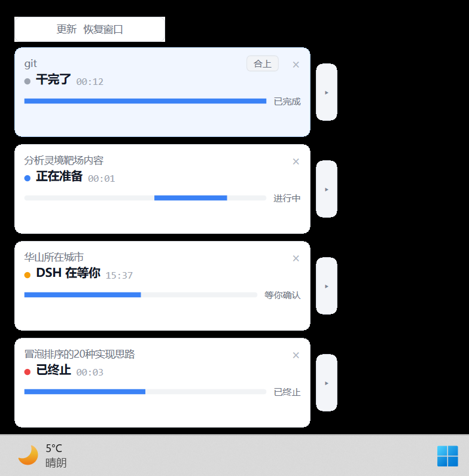

# dsh-work-cards

> 把"AI 现在在干嘛"做成桌面上看得见的东西。为 [DeepSeek Harness](https://github.com/deepseek-ai/deepseek-harness)（DSH）设计的 Windows 桌面浮窗插件。

**English**: Floating, draggable desktop cards for DeepSeek Harness. Each card shows one live session: what the agent is doing right now, coarse progress from its todo plan, elapsed time, a calibrated ETA range, and a stuck detector. Windows only (PowerShell + WPF), reads local session logs only, no network access.



## 这是什么

DSH 干活时，你只能盯着聊天窗口：切走就不知道它跑到哪了，切回来又得重读一遍上下文；同时开两三个会话，更是只能来回点。

这个插件把每个活跃会话变成桌面上一张**永远置顶的小卡片**，扫一眼就知道：

- **它在做什么**：联网搜索 / 翻文件 / 写代码 / 跑测试 / 构建 / 装依赖 / 在运行命令 / 正在琢磨
- **走到哪一步**：有 `todo_write` 清单时显示 `3/7 项`，没有就只报 `第 6 步`，不编百分比
- **跑了多久、大概还要多久**：按任务类型校准的区间（`约 4–7 分钟`），同类型样本不足 3 轮就不显示
- **有没有卡住**：30 秒没有新动作，直接标 `00:45 无动作`

三张卡片叠在一起，分别停在「进行中」「等你确认」「已终止」——**这不是一个催工用的倒计时，而是把 AI 的黑盒过程变成你能看懂的流程**。进度条只表达阶段（进行中循环、等你确认半条、完成满条），不承诺时间。

隐私上只有一条：**只读本地的会话日志，不联网、不上传**。
## 解决什么问题

跑长任务时人没法一直盯着界面。DSH 的界面切到别的窗口就看不见了，你只能反复切回来确认"跑完没、卡没卡"。

这个插件把每个活跃会话变成一张**永远置顶的小卡片**，放在屏幕角落：

```
插件
● 在写代码  window.ps1            02:14
▓▓▓▓▓▓░░░░  3/7 项 · 约 4–7 分钟   已完成
```

## 功能

- **一会话一卡片**：默认折叠成一张，点「展开 N」看全部
- **动作分类**：在联网搜索 / 在翻文件 / 在写代码 / 在跑测试 / 在构建 / 在装依赖 / 在运行命令 / 正在琢磨 / DSH 在等你 / 干完了
- **计划驱动进度**：有 `todo_write` 清单时显示 `3/7 项`；计划中途变化会显示 `计划 3→7`，不隐藏
- **校准 ETA**：按任务类型统计历史耗时，样本 ≥3 才显示 `约 4–7 分钟`（区间，不是单点）
- **卡住检测**：30 秒无新动作显示 `00:45 无动作`
- **可拖动**：位置按会话记住，重启后恢复
- **右侧浮层**：点箭头看最近 6 步动作（命令/文件/搜索词）
- **顶部工具条**：`更新` 立即刷新状态、`恢复窗口` 找回误关的卡片
- **完成提示**：任务结束时卡片边框闪 3 秒高亮（不依赖声音，音量静音也能看到）
- **终止识别**：用户主动停止的任务显示「已终止」（红点、半条），不当作完成
- **完成态**：浅蓝底 + `已完成`，不自动消失，等你点 `×`
- **进度条 = 状态灯**：进行中循环滑动、等你确认卡在半条、已完成满条
- **计划进度用文字**：有 `todo_write` 清单时显示 `3/7 项`（不塞进条里）

## 安装

```bash
dsh plugin --profile desktop add <本仓库或 npm 包>
```

或本地目录：

```bash
dsh plugin --profile desktop add link:/path/to/dsh-work-cards
```

装完重启 DSH。

## 配置

在 profile 的 `cordis.patch.yml` 里覆盖：

```yaml
- id: work-cards
  name: 'dsh-work-cards'
  config:
    intervalMs: 1000     # 刷新间隔（毫秒）
    maxCards: 6          # 最多几张卡
    todoReminder: true   # 是否给 agent 注入"先列计划"的系统提示
```

## 工作原理

```
~/.dsh/sessions/*/session.v4.jsonl.zstd   ← DSH 会话日志（zstd 分帧追加）
        │  按 zstd 帧头切开、逐帧解压（mtime+size 缓存 + 尾部增量）
        ▼
  collect.mjs：还原当前动作 / 已用时间 / todo 进度 / 任务类型
        │  每 1000ms 写 ~/.dsh/work-cards/state.json（原子替换，内容没变就跳过）
        ▼
  window.ps1：PowerShell + WPF 管理 N 个置顶窗口
```

- 单实例通过 `manager.lock`（独占文件锁）保证
- 插件随 DSH 启停，管理器由插件拉起并看护，崩溃自动重启

## 性能

采集逻辑做过一轮针对性优化（见 [CHANGELOG](CHANGELOG.md)），因为早期版本每 450ms 在 DSH host 的主线程上全量解压、解析所有会话日志，会让 DSH 主窗口启动变慢。

现在的做法：

- **先按 mtime 过滤 12 小时窗口**，再读文件；过期会话不会被解压
- **按 `路径 + size + mtime` 缓存**解析结果，文件没变时直接复用
- **尾部增量解析**：日志是 append-only 的 zstd 帧序列，只解析新增的完整帧；写了一半的帧留到下一拍
- **增量分析状态机**：事件只喂一次，稳定状态下每拍只做与卡片数成正比的收尾计算
- 默认 `intervalMs` 1000；首次采集延后 1.5s，避免和 host 启动抢主线程

本机基准（2 个活跃会话）：

| 场景 | 耗时 |
|---|---|
| 冷读（首次，启动时延后执行） | ~220ms |
| 文件没变 | **1.6ms** |
| 追加 1 个帧 | **10ms** |
| 手动刷新 | 52ms |

自带基准与测试：

```powershell
npm test          # 10 个用例：冷读/缓存/追加/半帧/重写/刷新/12h/多工作区/子代理/终止
npm run bench     # 合成数据基准（26 个会话）
```
## 已知限制

- **仅 Windows**：依赖 PowerShell 5.1 + WPF，macOS/Linux 上插件会安静退出
- **依赖日志格式**：读的是 `session.v4.jsonl.zstd`。DSH 若改动日志格式（v5 或帧结构），插件会**静默失效**，不会报错
- **进度是启发式**：有 todo 清单才给比例；没有时只显示"第 k 步"，不编百分比
- **ETA 是统计值**：同类型任务样本不足 3 轮时**不显示**；样本取自当前会话历史
- **不显示子代理**：只看根会话
- **12 小时保留**：会话超过 12 小时无活动后卡片自动移除
- **约 1 秒延迟**：跟随日志刷新，不是实时事件流

## 隐私

- **只读**：只读 `~/.dsh/sessions/` 下的会话日志，不修改任何会话数据
- **不联网**：无 HTTP、无遥测、无上传
- **写什么**：`~/.dsh/work-cards/` 下只有 `state.json`、`positions.json`（窗口坐标）、`dismissed.json`（关掉的卡片）、`window.log`（运行日志）
- **注意**：`state.json` 里会有**会话标题、命令描述、文件路径**。这和 DSH 自己的会话日志同级敏感——不要把 `~/.dsh` 打包外发

## 兼容性

- DSH `>= 0.2.2-rc.5`（`engines.dsh` 已声明）
- PowerShell 5.1（Windows 自带）
- 桌面端（desktop profile）；Web profile 没有置顶窗口能力

## 许可

MIT，见 [LICENSE](LICENSE)。
